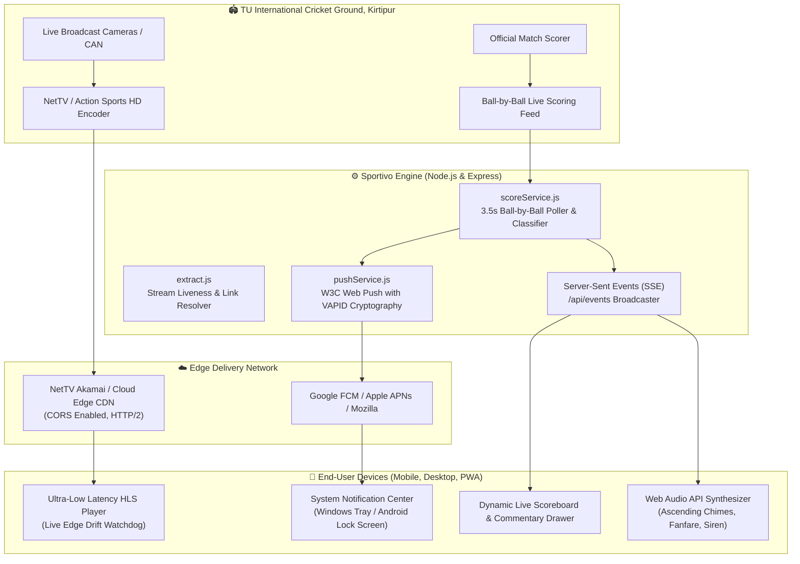

# 🏏 Sportivo — Nepal Premier League (NPL) Live Streaming & Real-Time Match Engine

<p align="center">
  
</p>

<p align="center">
  <strong>Engineered by <a href="https://www.dipeshsapkota7.com.np/">Dipesh Sapkota (@Dszae)</a></strong><br>
  <em>The official, ultra-low latency live cricket streaming hub, live score engine, and automated boundary alert platform for the Nepal Premier League (NPL).</em>
</p>

<p align="center">
  <a href="https://github.com/Dszae/NPL/stargazers"></a>
  <a href="https://github.com/Dszae/NPL/network/members"></a>
  <a href="https://www.dipeshsapkota7.com.np/"></a>
  <a href="https://github.com/Dszae"></a>
  
  
</p>

---

## 📌 Overview

**Sportivo NPL** is an open-source, production-ready sports streaming and live telemetry application built specifically for the **Nepal Premier League (NPL)** cricket tournament. 

Built from scratch by **[Dipesh Sapkota](https://www.dipeshsapkota7.com.np/)**, Sportivo solves the critical flaws of mainstream sports streaming platforms: high stream latency (30–45s lag), missing boundary notifications, intrusive ads, and broken multi-feed failovers.

### 🌟 Key Differentiators
- **⚡ Ultra-Low Latency Live Edge:** Slashes broadcast lag from standard ~35 seconds down to **~3.5 to 5 seconds** using adaptive `Hls.js` live synchronization.
- **🔔 Background Web Push Alerts:** Dispatches instant notifications and synthesized audio alerts for **4s, 6s, and Wickets** even when the page or browser is completely closed!
- **⏱️ Spoiler Prevention Offset:** An interactive slider that calibrates notification arrival with video frames so alerts never spoil the action before it happens on screen.
- **📝 Live Cricbuzz-Style Commentary:** Real-time ground delivery descriptions, bowler variations, and dismissal details updating every ball.
- **🛡️ Zero-Downtime Auto-Failover:** Automatically switches across NetTV Master Adaptive HD, 1080p 50FPS, 720p, and 480p feeds without interruption.
- **📺 Mini-Player (PiP) & Theater Mode:** Floating Picture-in-Picture window allows multitasking across code editors, browser tabs, or mobile applications.
- **📱 Progressive Web App (PWA):** Installable on Android, iOS, Windows, and macOS as a standalone native app with offline shell caching.
- **🔍 SEO & Sitelinks Architecture:** Schema.org JSON-LD structured data linking directly to [Dipesh Sapkota's engineering portfolio](https://www.dipeshsapkota7.com.np/).

---

## 🏗️ System Architecture



---

## 🚀 Features in Detail

### 1. ⚡ Ultra-Low Latency HLS Player
Standard HLS streaming buffers 3 full segments (each 10–12 seconds long), creating a 30–45 second delay behind real life.
Sportivo re-engineers this pipeline:
- **`liveSyncDurationCount: 2`**: Targets 1–2 segments behind the origin encoder.
- **Active Drift Watchdog**: Continuously measures drift (`hls.liveSyncPosition - video.currentTime`). If playback drifts by more than 15 seconds, it gently accelerates playback to `1.08x` to catch up seamlessly without buffering or pauses.
- **`⚡ Jump to Live Edge`**: Instant 1-click button to skip to the latest broadcast second.

### 2. 🔔 Real-Time Boundary & Wicket Notifications (Web Push API)
- Works **even if the browser window or tab is closed**!
- Backed by W3C Web Push Protocol and Service Worker Push handlers.
- **Synthesized Audio Tones (Web Audio API):**
  - 🏏 **Four (4):** Ascending harmonic chime ($C_5 \rightarrow E_5 \rightarrow G_5$)
  - 🚀 **Six (6):** Resonant brass fanfare ($G_4 \rightarrow C_5 \rightarrow E_5 \rightarrow G_5$)
  - 💥 **Wicket (W):** Dramatic tension siren drop ($880\text{ Hz} \rightarrow 180\text{ Hz}$)
- **Spoiler Prevention Slider:** Set a custom delay ($0.0\text{s} - 10.0\text{s}$) so alerts match the exact moment the ball crosses the boundary rope on your screen.

### 3. 🛡️ Multi-Source Auto-Failover
Configured with an intelligent fallback sequence:
1. `NetTV Master Adaptive HD` (Auto 1080p / 720p / 480p)
2. `NetTV 1080p 50FPS Full HD Feed`
3. `NetTV 720p HD Feed`
4. `NetTV 480p SD Data Saver`

If a source experiences consecutive fatal errors or bandwidth drops, the player seamlessly transitions to the next healthy feed within **1.5 seconds**.

### 4. 📝 Ball-by-Ball Commentary Drawer & Scoreboard
- Real-time runs, overs, and Current Run Rate (CRR).
- Active batters with runs, balls faced, $4\text{s}$, $6\text{s}$, and strike rates.
- Active bowler with current over bowling figures.
- Target chase equation (e.g., *"SPR need 120 runs in 98 balls"*).
- Color-coded recent balls strip:
  - 🟢 **Emerald:** Boundary Four ($4$)
  - 🟣 **Violet:** Maximum Six ($6$)
  - 🔴 **Crimson:** Wicket Fallen ($W$)
  - ⚪ **Dark:** Dot balls ($0$) and singles ($1$)

### 5. ⌨️ Keyboard Shortcuts
| Key | Action |
| :---: | :--- |
| <kbd>Space</kbd> | Play / Pause Stream |
| <kbd>M</kbd> | Mute / Unmute Audio |
| <kbd>F</kbd> | Toggle Fullscreen |
| <kbd>P</kbd> | Toggle Picture-in-Picture (Floating Mini-Player) |
| <kbd>L</kbd> | ⚡ Instant Jump to Live Edge |
| <kbd>T</kbd> | Toggle Theater Widescreen Mode |
| <kbd>N</kbd> | Toggle Background Notifications ON / OFF |

---

## 🛠️ Technology Stack

| Layer | Technologies |
| :--- | :--- |
| **Backend Runtime** | Node.js (v20+), Express.js 5 |
| **Stream Extraction** | Puppeteer, Fetch API, M3U8 Regex Parsers |
| **Caching Engine** | NodeCache (In-memory TTL store) |
| **Push Gateway** | Web-Push (VAPID Keys, RFC 8291 / RFC 8292) |
| **Real-Time Feed** | Server-Sent Events (SSE), HTTP/2 |
| **Frontend UI** | Semantic HTML5, CSS3 Variables, Glassmorphism UI |
| **Media Player** | HLS.js, HTML5 Video, Picture-in-Picture API |
| **Audio Engine** | Web Audio API (Zero external MP3 dependencies) |
| **PWA Platform** | Service Worker, Cache Storage API, Web App Manifest |
| **Containerization** | Docker, Bookworm-Slim, Chromium headless |

---

## 📦 Installation & Local Setup

### Prerequisites
- [Node.js](https://nodejs.org/) (version 20 or higher)
- [Git](https://git-scm.com/)

### 1. Clone the Repository
```bash
git clone https://github.com/Dszae/NPL.git
cd NPL
```

### 2. Install Dependencies
```bash
npm install
```

### 3. Run Development Server
```bash
npm start
```

### 4. Open Application
Navigate to **`http://localhost:3000`** in your browser.

---

## 🐳 Running with Docker

You can build and run Sportivo as an isolated container:

```bash
# Build the Docker image
docker build -t sportivo-npl .

# Run the container on port 3000
docker run -d -p 3000:3000 --name sportivo-live sportivo-npl
```

---

## 🔌 API Documentation

| Method | Endpoint | Description |
| :--- | :--- | :--- |
| `GET` | `/api/health` | Health check probe |
| `GET` | `/api/stream/auto` | Auto-discovers and returns the verified active HLS stream |
| `GET` | `/api/stream?id=NPL1` | Returns stream URL for a specific match channel |
| `GET` | `/api/score/live` | Returns live match score, batters, bowler, and commentary |
| `GET` | `/api/events` | Server-Sent Events (SSE) live push stream |
| `GET` | `/api/push/public-key` | Returns VAPID public key for Web Push subscription |
| `POST` | `/api/push/subscribe` | Registers a browser push subscription for background alerts |
| `POST` | `/api/push/unsubscribe` | Removes a browser push subscription |
| `POST` | `/api/test-notification?type=SIX` | Dispatches a simulated event (`FOUR`, `SIX`, `WICKET`) for testing |

---

## 🔍 Search Engine Optimization (SEO) & Sitelinks

Sportivo is engineered with rich **Schema.org JSON-LD structured data**:
- **`WebSite` Schema:** Sitelinks SearchBox integration (`SearchAction`).
- **`SportsEvent` Schema:** Nepal Premier League match schedule, competitors, and virtual broadcast venue.
- **`BreadcrumbList` Schema:** Multi-tier breadcrumb linking directly to [Dipesh Sapkota's main portfolio](https://www.dipeshsapkota7.com.np/).
- **`Person` Schema:** Author identity graph linking GitHub, Dev.to, and personal domain.
- **Sitemap & Robots:** Fully compliant `robots.txt` and `sitemap.xml` with Google Video Search tags.

---

## 👨‍💻 About the Author

**Dipesh Sapkota (@Dszae)**  
*Computer Engineering Student, AI/ML Researcher & Full-Stack Systems Developer*  
Kathmandu, Nepal

- 🌐 **Official Portfolio:** [https://www.dipeshsapkota7.com.np/](https://www.dipeshsapkota7.com.np/)
- 💻 **GitHub:** [@Dszae](https://github.com/Dszae)
- 📝 **DEV Community:** [@dszae](https://dev.to/dszae)
- 📧 **Email:** [dsz.ae18@gmail.com](mailto:dsz.ae18@gmail.com)

### Other Featured Projects by Dipesh Sapkota
- **[IOE Admission Hub (IOE Predictor)](https://github.com/Dszae/ioe-admission-guide):** Comprehensive statistical rank predictor, priority form generator, and cutoff analytics platform for Tribhuvan University Institute of Engineering applicants.
- **Git Visualizer:** Interactive commit history and branch flow simulator.

---

## 📄 License

This project is licensed under the [ISC License](LICENSE). Built for educational, sports community, and research purposes.

---

<p align="center">
  <sub>Developed with ❤️ in Kathmandu, Nepal by <strong>Dipesh Sapkota</strong> &bull; Nepal Premier League 2026</sub>
</p>
